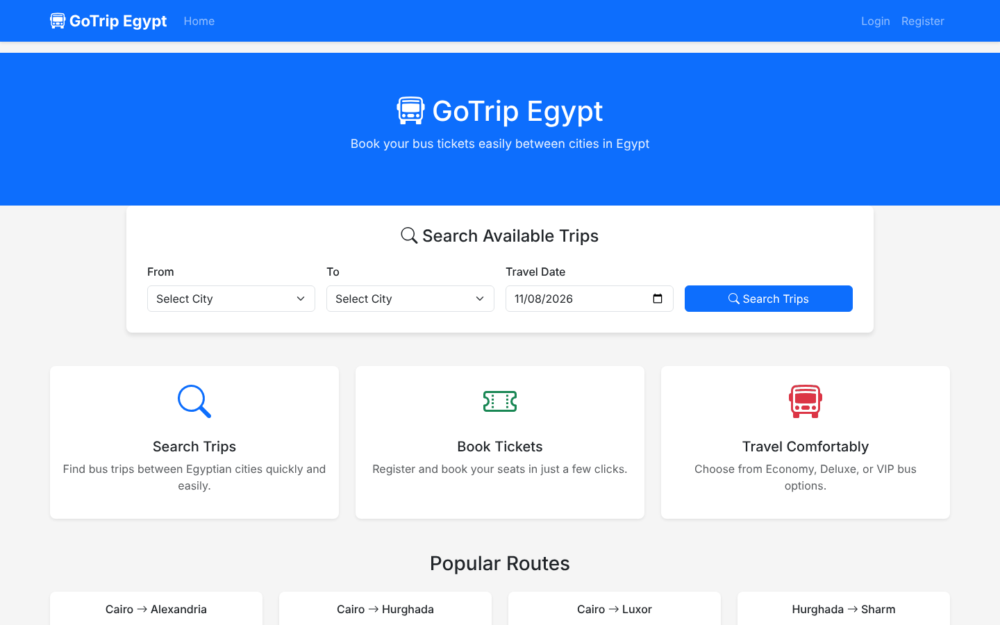
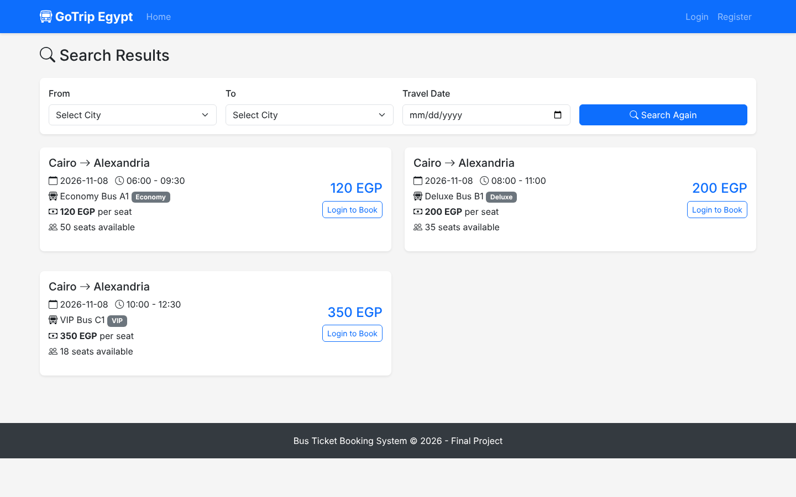
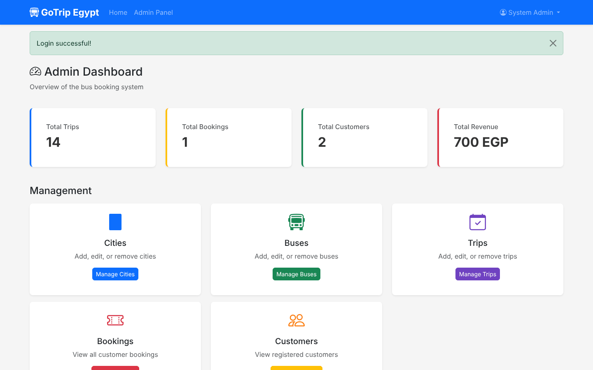

# GoTrip Egypt — Bus Booking Web App

A bus-ticket booking system for trips between Egyptian cities, built with Python and Flask. Customers search trips and book seats; admins manage cities, buses, trips and bookings.



| Search results | Admin dashboard |
| --- | --- |
|  |  |

## Features

**Customers**
- Search trips by origin, destination and date
- Register, log in and book seats on Economy, Deluxe or VIP buses
- Pay by card or cash, then view or cancel bookings

**Admins**
- Dashboard with trips, bookings, customers and revenue
- Add, edit and remove cities, buses and trips
- View all bookings and registered customers

**Security**
- Passwords hashed with PBKDF2-SHA256
- Login rate limiting (15-minute lockout after repeated failures)
- Security headers including Content-Security-Policy and X-Frame-Options
- HttpOnly, SameSite and (in production) Secure session cookies
- Input sanitising and parameterised SQL queries

## Built with

Python · Flask · SQLite · Bootstrap 5 · gunicorn

## Run it locally

```bash
cd bus_booking_project/bus_booking_project
pip install -r requirements.txt
python init_db.py      # creates the demo database with sample trips
flask --app app run
```

Demo logins: `customer@example.com` / `customer123` and `admin@example.com` / `admin123`.

## Live demo (Render)

[](https://render.com/deploy?repo=https://github.com/Mostafa-Habib365/Bus-Booking-Project)

`render.yaml` deploys the app on Render's free plan with gunicorn. The SQLite demo database is rebuilt with fresh sample trips each time the service starts, so demo bookings reset after a restart or when the free service wakes from sleep.

---

Built by [Mostafa Habib](https://mostafa-habib.y98d7h5mkk.workers.dev/) — secure, fast websites for small businesses.
